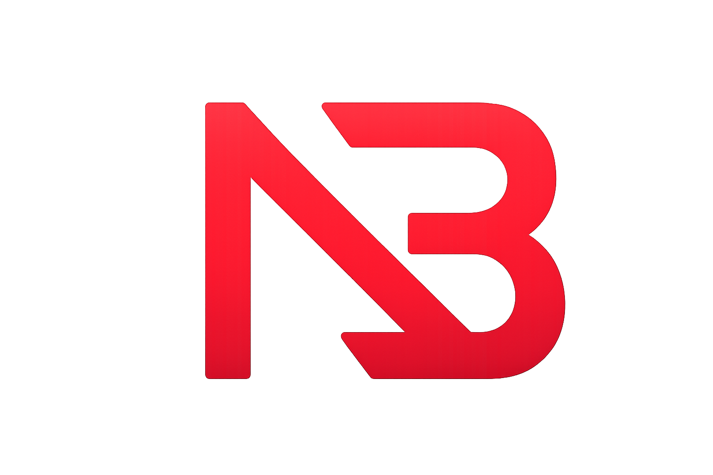
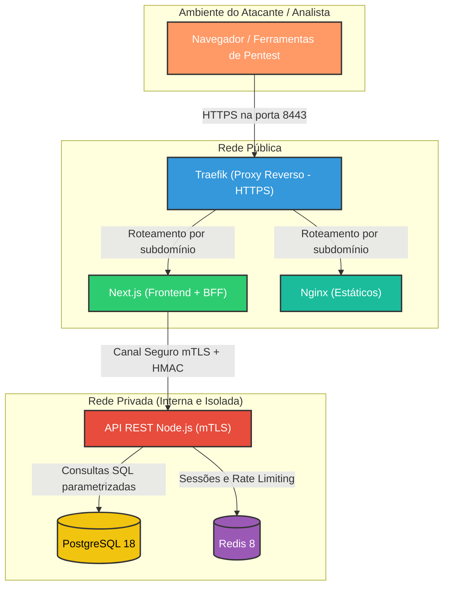
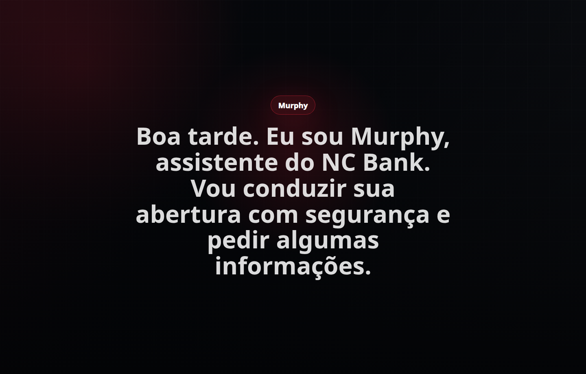
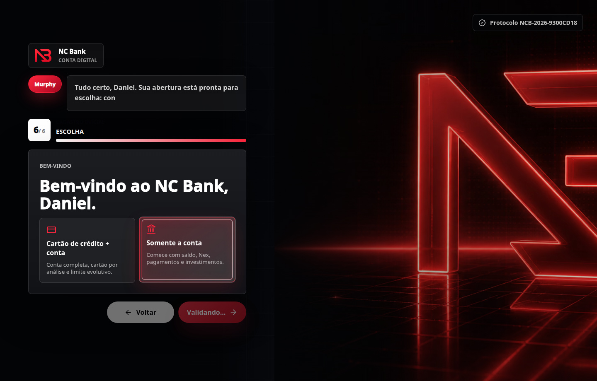
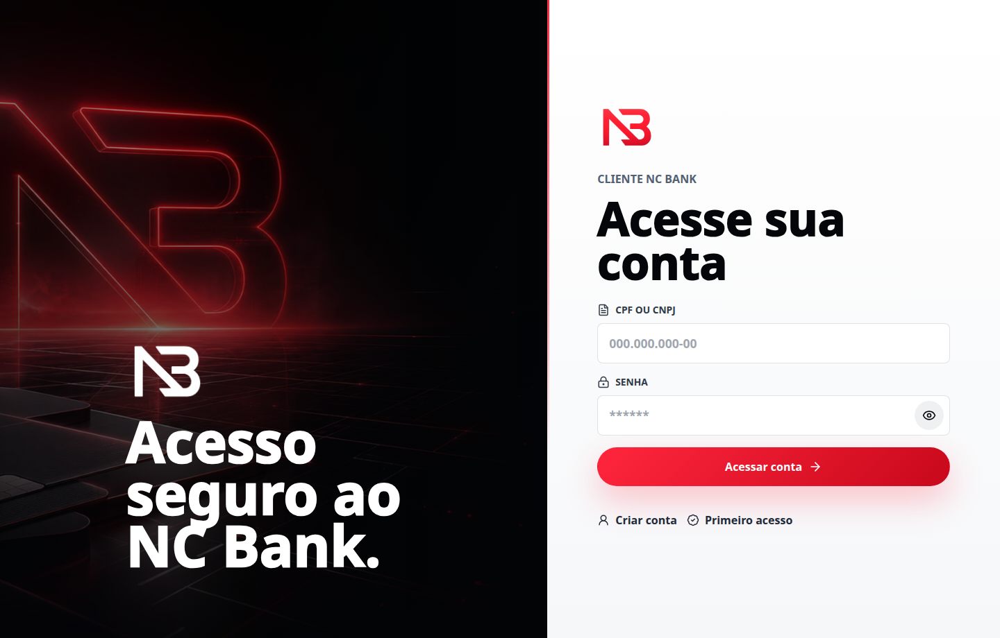
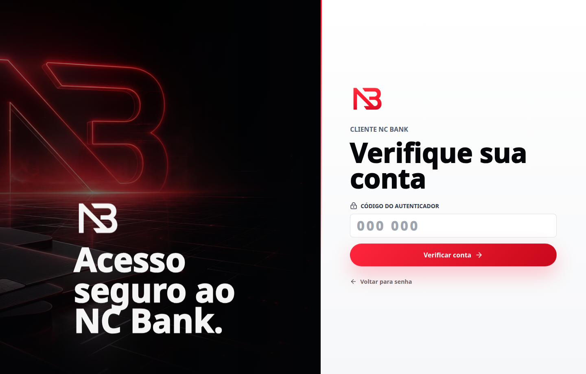
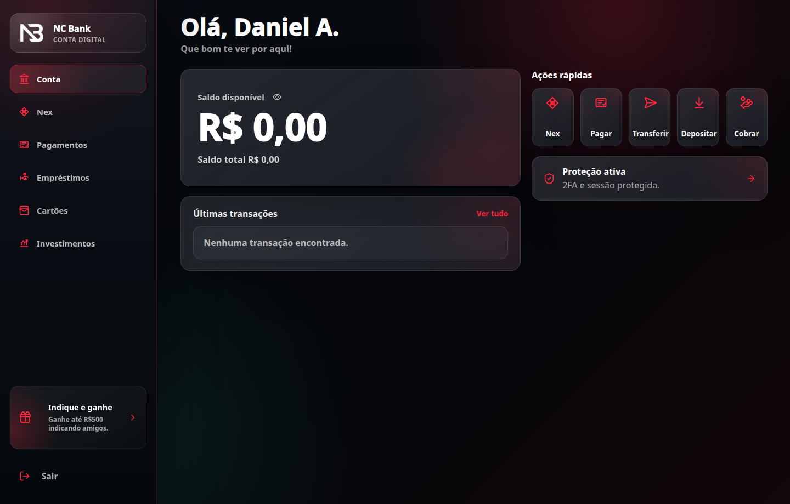
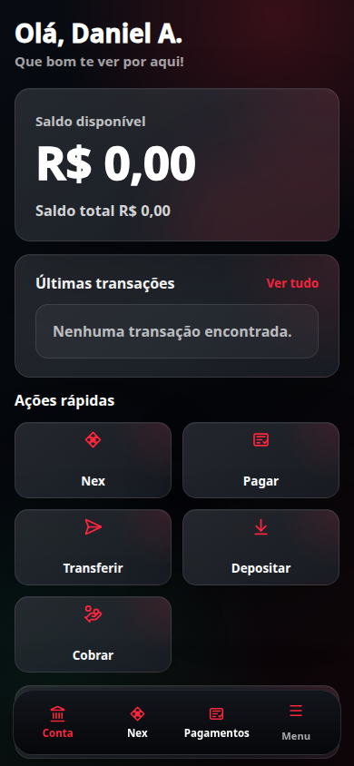
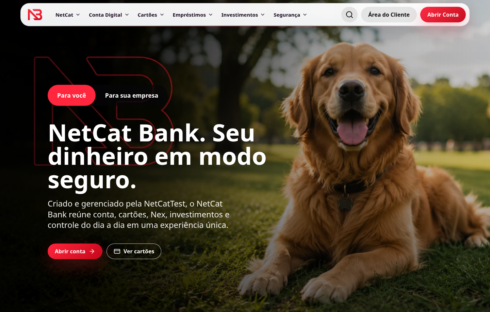

# NCBank



O NCBank é um projeto voltado para a área de cibersegurança, funcionando como um laboratório prático para a exploração de vulnerabilidades e testes de invasão de forma totalmente ética. O sistema foi desenvolvido com o objetivo de reproduzir fielmente a estrutura e as operações de um banco.

Inicialmente, o projeto foi planejado para ter uma parte web hospedada em uma VPS, onde qualquer pessoa poderia acessar remotamente e tentar realizar invasões de maneira pública. No entanto, devido ao tempo limitado, esse modelo precisou ser adaptado e o acesso externo irrestrito não foi implementado.

---

## 🎨 Design e Interfaces

Abaixo estão algumas imagens que ilustram as interfaces, paletas e simulações do nosso laboratório:


---

## 🛠 Tecnologias Utilizadas

O laboratório foi construído utilizando um conjunto de ferramentas modernas que garantem desempenho e proximidade com ambientes bancários reais.

| Tecnologia | Função no Laboratório |
| :--- | :--- |
| **Node.js** (v22.20+) | Runtime principal para a API e ferramentas de segurança. |
| **TypeScript** | Tipagem estática em toda a base de código, reduzindo vulnerabilidades em tempo de compilação. |
| **React** | Biblioteca para construção das interfaces interativas do banco. |
| **Next.js** | Framework fullstack para o frontend, atuando também como BFF (Backend For Frontend) no canal seguro. |
| **PostgreSQL 18** | Banco de dados relacional para persistência de contas, transações e ledger financeiro. |
| **Redis 8** | Cache de alta performance para gerenciamento de sessões e controle de taxa de requisições. |
| **Docker & Docker Compose** | Containerização e orquestração de todos os serviços em redes isoladas. |
| **Traefik v3** | Proxy reverso com redirecionamento HTTPS automático e middlewares de cabeçalhos seguros. |
| **OpenSSL** | Geração de certificados mTLS internos com curvas elípticas para comunicação entre serviços. |
| **Nginx** | Servidor dedicado para arquivos estáticos com configuração restritiva. |

---

## 🏗 Arquitetura do Projeto

O diagrama abaixo ilustra detalhadamente o fluxo de requisições e a organização dos serviços simulados pelo laboratório. Como o foco é cibersegurança, conhecer a arquitetura completa é o primeiro passo para o mapeamento da superfície de ataque.



### Isolamento de Redes

O ambiente é dividido em três redes Docker distintas:

| Rede | Serviços | Função |
| :--- | :--- | :--- |
| **rede-publica** | Traefik, Frontend, Estáticos | Acessível pelo navegador do usuário. |
| **rede-privada** | API, PostgreSQL, Redis | Totalmente isolada, sem acesso externo direto. |
| **rede-saida** | API | Permite que a API faça requisições externas controladas. |

---

## 🌐 Subdomínios e Acesso Local

O Traefik roteia as requisições por subdomínio, simulando a estrutura de um banco digital real com áreas completamente separadas. Após subir o laboratório, os seguintes endereços ficam disponíveis:

| Subdomínio | Endereço Local | Descrição |
| :--- | :--- | :--- |
| **Página Institucional** | `https://netcatbank.localtest.me:8443` | Página inicial do banco com informações e navegação. |
| **Abertura de Conta** | `https://abrir-conta.netcatbank.localtest.me:8443` | Fluxo completo de abertura para pessoa física (CPF) e pessoa jurídica (CNPJ). |
| **Área do Cliente** | `https://cliente.netcatbank.localtest.me:8443` | Painel financeiro do cliente autenticado com saldo, extrato e operações. |
| **Dashboard** | `https://painel.netcatbank.localtest.me:8443` | Painel administrativo com visão geral do sistema. |
| **Indicações** | `https://indique.netcatbank.localtest.me:8443` | Programa de indicações com geração de links e controle de bônus. |
| **Estáticos (CDN)** | `https://estaticos.netcatbank.localtest.me:8443` | Servidor dedicado para fontes, imagens e CSS da marca. |

A API **não possui subdomínio público**. O domínio `api.netcatbank.com` é mantido intencionalmente sem registro DNS, garantindo que a API só seja acessível internamente pelo BFF através do canal seguro com mTLS. Toda comunicação do navegador com a API passa obrigatoriamente pelo proxy BFF em `/canal-seguro-api/`.

---

## 🏦 Funcionalidades Bancárias

O laboratório reproduz funcionalidades reais de um banco digital. Abaixo estão os módulos operacionais implementados:

### Abertura de Conta

O fluxo de abertura está disponível em `https://abrir-conta.netcatbank.localtest.me:8443` e contempla:

- Abertura para pessoa física (CPF) e pessoa jurídica (CNPJ)
- Validação algorítmica de CPF e CNPJ com dígitos verificadores
- Consulta automática de dados públicos de CNPJ via BrasilAPI
- Verificação anti-enumeração de documentos e e-mails
- Sessão de abertura temporária com expiração
- Opções de produto: conta simples ou conta com crédito
- Normalização inteligente de nomes com filtro de termos bloqueados
- Cadastro de senha numérica de 6 dígitos com validação rigorosa
- Informação de data de nascimento com verificação de maioridade (18+)





### Autenticação e Sessões

O login é feito pela área do cliente em `https://cliente.netcatbank.localtest.me:8443`:

- Login com documento (CPF/CNPJ) e senha numérica de 6 dígitos
- Validação rigorosa de senha: rejeita sequências, repetições, datas de nascimento, padrões aritméticos e pares previsíveis
- Autenticação em dois fatores (TOTP) com geração de QR Code compatível com aplicativos autenticadores
- Sessões vinculadas ao contexto de rede (IP + User-Agent); mudança invalida a sessão
- Expiração automática por inatividade (25 minutos)
- Cookie de sessão com `SameSite=Strict`, `Secure`, `HttpOnly` e domínio restrito





### Painel Financeiro

Após o login, o cliente acessa o painel completo em `https://painel.netcatbank.localtest.me:8443` contendo:

- **Saldo** — Visualização do saldo disponível, total e contábil com verificação de integridade HMAC
- **Extrato** — Histórico completo com filtros por tipo (entrada/saída), categoria, período e pesquisa textual
- **Gráficos** — Visualização mensal de gastos agrupados por categoria
- **Nex** — Sistema de transferências instantâneas (detalhado abaixo)
- **Pagamentos** — Pagamento de boletos e recarga de celular
- **Empréstimos** — Consulta de elegibilidade de crédito
- **Transações** — Detalhes individuais de cada movimentação com comprovante
- **Agendamentos** — Transferências programadas para datas futuras



<div align="center">
  
</div>

### Sistema Nex (Transferências Instantâneas)

O Nex é o sistema de transferências instantâneas do NCBank, acessível dentro do painel:

- Cadastro de chaves Nex por tipo: CPF, CNPJ, e-mail, telefone ou aleatória
- Resolução de destinatário por chave com verificação de chave ativa
- Fluxo em duas etapas: preparação (reserva de saldo) e confirmação
- Lock pessimista ordenado por `conta_id` com `SELECT FOR UPDATE` para prevenir deadlocks
- Validação cruzada de chave ativa tanto na origem quanto no destino
- Agendamento de transferências futuras com processamento automático
- Geração de QR Code para recebimento com valor e descrição
- Histórico de atividades Nex com paginação e pesquisa

### Pagamentos e Cobranças

- Pagamento de boletos bancários com validação de linha digitável
- Verificação de dígitos módulo 10 e módulo 11
- Proteção contra liquidação duplicada de boletos
- Recarga de celular com validação de telefone e valores pré-definidos

### Doações

- Doação para o Instituto Murzo com valores livres
- Registro contábil completo com partidas dobradas

### Empréstimos e Crédito

- Modelo de elegibilidade de crédito com faixas: em análise, inicial, moderada e forte
- Limite de crédito calculado com taxa mensal
- Métricas de análise cifradas e assinadas com HMAC

### Extrato e Movimentações Financeiras

- Extrato completo com filtros por tipo (entrada/saída), categoria, período e pesquisa textual
- Categorias: geral, moradia, alimentação, transporte, lazer, serviços, pagamentos, doações, investimentos, bônus, cartões
- Ordenação por data (recentes/antigas) ou valor (maior/menor)
- Paginação com contagem total de registros

### Comprovantes Digitais

- Geração de comprovantes com assinatura digital Ed25519
- Estrutura verificável contendo: snapshot do movimento, participantes, chave pública, digest e assinatura
- Renderização em imagem PNG para compartilhamento

### Programa de Indicações

Acessível em `https://indique.netcatbank.localtest.me:8443`:

- Geração de links de indicação com código único
- Controle de bônus por indicação liquidada
- Campanhas com limite máximo de indicações (20 por campanha)
- Janela silenciosa de 24 horas para indicações recebidas
- Bloqueio automático de indicações irregulares

### Página Institucional

A página inicial do banco em `https://netcatbank.localtest.me:8443` apresenta a marca e os serviços:



### Página de Erro e Rate Limiting

O laboratório possui páginas de erro personalizadas e proteção contra excesso de requisições:


---

## 🔒 Segurança Implementada

O NCBank implementa camadas reais de segurança, reproduzindo padrões encontrados em instituições financeiras. Abaixo está o detalhamento completo de cada mecanismo:

### Criptografia de Transporte (Envelope Seguro v3)

Toda comunicação sensível entre o navegador e a API passa por um envelope criptográfico próprio denominado **NCBANK-ECDH-P256-A256GCM-v3**:

| Componente | Algoritmo / Técnica |
| :--- | :--- |
| **Acordo de chaves** | ECDH com curva P-256 (prime256v1), chave efêmera por requisição. |
| **Derivação de chave** | HKDF-SHA256 com sal derivado do AAD (Dados Adicionais Autenticados). |
| **Cifra simétrica** | AES-256-GCM com IV aleatório de 12 bytes e tag de autenticação de 128 bits. |
| **Integridade do payload** | HMAC-SHA256 sobre o payload canônico, vinculado ao CSRF e sinal do cliente. |
| **Integridade do envelope** | HMAC-SHA256 sobre a estrutura pública do envelope, impedindo adulteração. |
| **Verificação de integridade runtime** | FNV-1a de 32 bits cruzado entre hashes do AAD e payload, verificado em WebAssembly. |

### Autenticação Mútua entre Serviços (mTLS)

A comunicação entre o frontend (BFF) e a API interna é protegida por certificados mTLS gerados com curvas elípticas:

| Parâmetro | Valor |
| :--- | :--- |
| **Algoritmo da CA** | EC P-384 com SHA-384 |
| **Certificados de serviço** | EC P-384 com SHA-384, validade de 825 dias |
| **Verificação de CN** | O servidor API valida que o certificado do cliente possui o CN esperado (`bff.netcatbank.interno`) |
| **TLS mínimo** | TLSv1.3 obrigatório no healthcheck da API |

### Proteção Anti-Replay e Anti-Adulteração

| Mecanismo | Descrição |
| :--- | :--- |
| **Nonce por requisição** | Cada envelope carrega um nonce aleatório de 24 bytes, impedindo reuso. |
| **Timestamp vinculado** | O campo `_ncEmitidoEm` registra o momento exato da criação do envelope. |
| **Sequência por fluxo** | Contador `_ncSeq` incremental por fluxo e rota, detectando pacotes fora de ordem. |
| **Idempotência** | Chave única `_ncIdempotencia` por operação, prevenindo execução duplicada. |
| **Vinculação de contexto de rede** | Hash do IP + User-Agent da sessão é verificado a cada requisição; mudança invalida a sessão. |
| **Expiração de chave de transporte** | Chaves ECDH efêmeras expiram em 90 segundos, limitando a janela de ataque. |

### Criptografia em Repouso

| Dado | Método |
| :--- | :--- |
| **Dados pessoais** (nome, e-mail, CPF, data de nascimento) | AES-256-GCM com IV aleatório por campo. Nenhum dado pessoal é armazenado em texto claro no banco. |
| **Índices de busca** | HMAC-SHA256 cego (busca por hash sem expor o valor original). |
| **Senhas** | scrypt com sal aleatório de 18 bytes e saída de 512 bits. |

### Integridade Financeira (Ledger)

| Mecanismo | Descrição |
| :--- | :--- |
| **Hash encadeado** | Cada lançamento financeiro é encadeado ao anterior via HMAC-SHA256, formando uma cadeia verificável como uma blockchain. |
| **Árvore de Merkle** | Partidas de lançamento dobrado são organizadas em árvore de Merkle, permitindo auditoria parcial. |
| **Partidas dobradas** | Toda transação gera débito e crédito correspondentes em contas contábeis distintas, como em contabilidade real. |
| **Assinatura de saldo** | O saldo de cada conta possui um HMAC-SHA256 de integridade vinculado ao ID, valores e versão. |
| **Bloqueio otimista** | Atualizações de saldo usam `WHERE versao = N` (versionamento), impedindo condições de corrida. |
| **SELECT FOR UPDATE** | Transferências entre contas utilizam lock pessimista ordenado por `conta_id` para prevenir deadlocks. |

### Proteções na Camada Web

| Proteção | Implementação |
| :--- | :--- |
| **CSRF** | Token HMAC-SHA256 com nonce, timestamp e hash de contexto, validado em double-submit via cookie + header. Expira em 30 minutos. |
| **CORS** | Lista restrita de origens permitidas, sem wildcard. Métodos fora do contrato são rejeitados (404/405). |
| **CSP** | `default-src 'self'`, `object-src 'none'`, `frame-ancestors 'none'`. |
| **HSTS** | Strict-Transport-Security com `includeSubDomains` e validade de 1 ano. |
| **Cookies** | `SameSite=Strict`, `Secure`, `HttpOnly`, com `Domain` restrito. |
| **Isolamento de origem** | Header `Origin-Agent-Cluster: ?1` habilitado. |
| **Cabeçalhos de segurança** | `X-Content-Type-Options: nosniff`, `Referrer-Policy: no-referrer`, `Permissions-Policy` restritiva. |
| **Sinal do cliente** | Hash SHA-256 do User-Agent vinculado a cada sessão, detectando roubo de cookie. |
| **Fetch Metadata** | Validação dos headers `Sec-Fetch-*` do navegador. |
| **Expiração de sessão** | Sessões expiram após 25 minutos de inatividade. |
| **TOTP (2FA)** | Autenticação em dois fatores com TOTP (SHA-1, janela de 30 segundos) para operações sensíveis. |

### Proteções de Infraestrutura Docker

| Proteção | Descrição |
| :--- | :--- |
| **no-new-privileges** | Todos os contêineres rodam com `security_opt: no-new-privileges`. |
| **cap_drop: ALL** | Todas as capabilities do Linux são removidas dos serviços. |
| **read_only** | O contêiner de estáticos roda em modo somente leitura. |
| **API sem exposição pública** | A API não possui roteador público no Traefik; só é acessível internamente via BFF. |
| **DNS público inexistente** | O domínio `api.netcatbank.com` não resolve publicamente. |
| **Healthcheck via mTLS** | O healthcheck da API exige certificado de monitor válido para responder. |

---

## ⚙️ Como Rodar o Laboratório Localmente

### Pré-requisitos

- **Node.js** (versão 22.20.0 ou superior)
- **NPM** (versão 10.0.0 ou superior)
- **Docker** e **Docker Compose**

### Passos de Instalação e Inicialização

1. Clone o repositório e entre na pasta do projeto:
   ```bash
   git clone https://github.com/netcattest/nc-bank
   cd NCBANK
   ```

2. Instale as dependências locais base do projeto:
   ```bash
   npm install
   ```

3. Gere os certificados mTLS internos para comunicação segura entre os serviços:
   ```bash
   npm run preparar:mtls
   ```

4. Suba o ambiente interno completo através do Docker:
   ```bash
   npm run desenvolver
   ```

Aguarde a finalização da construção das imagens e o aviso de que os contêineres estão rodando. Uma vez iniciados, o laboratório estará no ar e acessível pelo `localhost` na porta `8443`, pronto para receber simulações de ataque.

Para parar o ambiente:
```bash
npm run parar
```

---

## 📂 Caminhos e Estrutura Local

```
NCBANK/
├── aplicacoes/
│   ├── api/                 → API REST (Node.js + TypeScript)
│   │   └── src/
│   │       ├── servidor.ts  → Rotas e lógica principal do servidor
│   │       ├── banco.ts     → Queries SQL e operações financeiras
│   │       ├── seguranca.ts → Criptografia, envelopes, CSRF, cookies
│   │       ├── totp.ts      → Geração e validação TOTP (2FA)
│   │       └── validacao.ts → Validação de entradas
│   └── frente/              → Frontend (Next.js + React)
│       └── src/
│           ├── seguranca/
│           │   ├── transporte.ts                  → Canal seguro cliente-servidor
│           │   └── motor-criptografico.worker.ts   → Web Worker de criptografia
│           ├── componentes/  → Componentes React
│           ├── configuracao/ → Configurações do frontend
│           └── proxy.ts      → Proxy BFF para a API
├── ferramentas/
│   ├── verificar-seguranca-api.mjs  → Suite de testes de segurança automatizados
│   ├── gerar-mtls-interno.mjs       → Gerador de certificados mTLS
│   ├── preparar-marca.mjs           → Gerador de assets da marca
│   └── verificar-fluxo-visual.mjs   → Testes visuais automatizados
├── infraestrutura/
│   ├── banco-dados/         → Scripts de inicialização do PostgreSQL
│   ├── proxy/               → Configurações do Traefik
│   └── estaticos/           → Configuração do Nginx
├── documentacao/
│   ├── arquitetura-inicial.md → Documento de arquitetura inicial do projeto
│   └── mtls-interno.md        → Documentação do sistema de certificados mTLS
├── artefatos/               → Capturas e evidências de testes
├── test-results/            → Resultados dos testes visuais automatizados
├── segredos/
│   └── mtls/                → Certificados mTLS gerados localmente
└── compose.desenvolvimento.yml  → Orquestração de todos os serviços
```

---

## 📄 Licença

Este projeto é distribuído sob a licença MIT. Consulte o arquivo [LICENSE](./LICENSE) para mais detalhes.
